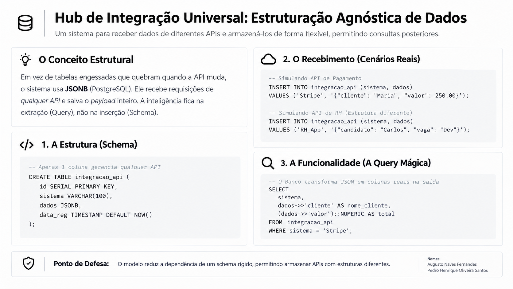

# 🔗 Integration Hub: Hub de Integração e Consulta de Dados

Trabalho de **Banco de Dados NoSQL** (UFU).
Augusto Naves Fernandes · Pedro Henrique Oliveira Santos

Sistema que **recebe dados de diferentes APIs** (Stripe, RH, ERP, CRM...), guarda o
**payload original** numa estrutura flexível no **MongoDB Atlas** e permite **consultas posteriores**,
sem exigir que todos os sistemas externos usem o mesmo formato.

> **Ponto de defesa:** documentos com estruturas completamente diferentes convivem
> na **mesma coleção** (`api_records`), sem alterar o schema. A inteligência fica na
> consulta, e não na inserção.



---

## 📁 Estrutura do repositório

```
.
├── README.md
├── docs/
│   ├── system-description.md      # Problema, objetivo e funcionalidade principal
│   └── database-architecture.md   # Banco, coleções, índices e comparação com JSONB
├── database/                      # Scripts para o mongosh
│   ├── init.js                    # Cria banco, coleções e índices
│   ├── seed.js                    # Insere fontes e documentos fictícios
│   └── queries.js                 # 12 consultas de demonstração
├── examples/                      # Payloads de exemplo de cada API
├── db.py                          # Conexão com o Atlas (lê o .env)
├── setup_db.py                    # Equivalente Python de init.js + seed.js
├── main.py                        # API FastAPI (recebimento e consultas)
├── app.py                         # Interface Streamlit (demonstração)
├── requirements.txt
└── .env.example                   # Modelo de configuração (sem senha)
```

## 🗄️ Banco de dados

| Coleção       | Papel                                                                  |
| ------------- | ---------------------------------------------------------------------- |
| `api_sources` | Catálogo das fontes integradas (Stripe, RH App, CRM, ERP)              |
| `api_records` | **Coleção principal.** Metadados fixos + `payload` com estrutura livre |

Detalhes em [docs/database-architecture.md](docs/database-architecture.md).

---

## 🚀 Como executar

### 1. MongoDB Atlas
1. Crie uma conta em [mongodb.com/atlas](https://www.mongodb.com/cloud/atlas) e um cluster gratuito **M0**.
2. **Database Access:** crie um usuário com senha.
3. **Network Access:** libere seu IP (ou `0.0.0.0/0` para testes).
4. **Connect → Drivers → Python:** copie a connection string.

> Não é preciso criar o banco nem as coleções pelo painel. Os scripts fazem isso.

### 2. Configuração local
```bash
git clone <url-do-repo> && cd <repo>
python3 -m venv .venv
source .venv/bin/activate
pip install -r requirements.txt

cp .env.example .env    # edite e cole sua connection string em MONGODB_URI
```

> ⚠️ **Nunca** versione o `.env`. Ele já está no `.gitignore`.

### 3. Criar a estrutura e popular o banco

**Opção A: Python (não precisa de mongosh)**
```bash
python setup_db.py --seed      # cria coleções, índices e dados de demonstração
python setup_db.py --reset     # (opcional) apaga tudo e recria
```

**Opção B: mongosh**
```bash
mongosh "mongodb+srv://<cluster>.mongodb.net/" --username <usuario>
```
```javascript
load("database/init.js")
load("database/seed.js")
load("database/queries.js")
```

### 4. Subir a API e o Frontend

**Passo 1: Subir a API (Backend FastAPI)**
```bash
uvicorn main:app --reload      # API REST → http://localhost:8000/docs
```

**Passo 2: Escolha a Interface Visual:**

* **Opção 1: Frontend Moderno em React + Vite (Recomendado)**
  ```bash
  cd frontend
  npm install
  npm run dev                  # Aplicação Web → http://localhost:5173
  ```

* **Opção 2: Frontend em Streamlit (Python puro)**
  ```bash
  streamlit run app.py         # Aplicação Streamlit → http://localhost:8501
  ```

---

## 🔌 Endpoints da API

| Método | Rota                                  | Descrição                                        |
| ------ | ------------------------------------- | ------------------------------------------------ |
| GET    | `/`                                   | Saúde da API e conexão com o MongoDB             |
| GET    | `/sources`                            | Lista as fontes cadastradas                      |
| POST   | `/sources`                            | Cadastra uma nova fonte                          |
| PATCH  | `/sources/{id}?active=false`          | Ativa/desativa uma fonte                         |
| GET    | `/sources/{id}/fields`                | Descobre os campos que a fonte envia no payload  |
| POST   | `/records/{source_id}`                | **Recebe um payload de qualquer formato**        |
| GET    | `/records?source_id=stripe`           | Lista os documentos brutos                       |
| GET    | `/records/{id}/filter?field=status&value=paid` | Filtra por campo interno do payload     |
| GET    | `/records/{id}/extract?fields=customer&fields=amount` | **Query Mágica** (payload → colunas) |
| GET    | `/stats`                              | Registros por fonte (`$group` + `$lookup`)       |

Exemplo de recebimento:
```bash
curl -X POST http://localhost:8000/records/stripe \
  -H "Content-Type: application/json" \
  -d '{"external_id": "evt_999", "payload": {"customer": "Ana", "amount": 99.9, "status": "paid"}}'
```

---

## 🎤 Roteiro da demonstração

1. **Visão geral** → mostrar as fontes em `api_sources` e a contagem por fonte.
2. **Documentos brutos** → abrir um registro da Stripe e um do ERP: formatos diferentes, mesma coleção.
3. **Simular API** → enviar um payload novo, ou até inventar campos novos: o banco aceita sem migração.
4. Reenviar o **mesmo `external_id`** → o índice único parcial bloqueia a duplicata (HTTP 409).
5. **Cadastrar nova fonte** na barra lateral → enviar dados dela sem criar coleção nova.
6. **Query Mágica** → escolher campos e ver o payload virar tabela, com o pipeline exibido.

## 🧭 Fora do escopo (evolução futura)
Conexão automática com APIs reais (webhooks), autenticação das integrações,
sincronização automática e validação de schema por fonte (`$jsonSchema`).
