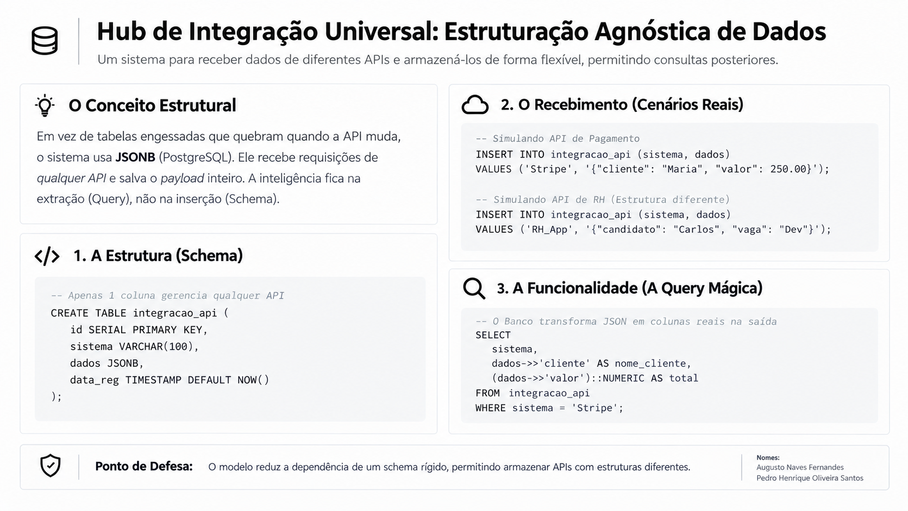

# 🔗 Integration Hub: Hub de Integração e Consulta de Dados

Trabalho de **Banco de Dados NoSQL** (UFU).
Augusto Naves Fernandes · Pedro Henrique Oliveira Santos

Sistema que **recebe dados de diferentes APIs** (Stripe, RH, ERP, CRM...), guarda o
**payload original** numa estrutura flexível no **MongoDB Atlas** e permite **consultas posteriores**,
sem exigir que todos os sistemas externos usem o mesmo formato.

> **Ponto de defesa:** documentos com estruturas completamente diferentes convivem
> na **mesma coleção** (`api_records`), sem alterar o schema. A inteligência fica na
> consulta, e não na inserção.



---

## 📁 Estrutura do repositório

```
.
├── docker-compose.yml         # Container do Redis Stack (Redis + RedisBloom + RedisInsight)
├── README.md
├── docs/
│   ├── system-description.md      # Problema, objetivo e funcionalidade principal
│   └── database-architecture.md   # Banco, coleções, índices e comparação com JSONB
├── database/                      # Scripts para o mongosh
│   ├── init.js                    # Cria banco, coleções e índices
│   └── seed.js                    # Insere fontes e documentos fictícios
├── frontend/                      # Aplicação Web Moderna (React + Vite + Tailwind/CSS)
│   ├── src/
│   │   ├── App.jsx                # Interface com as 6 abas e chamadas às APIs
│   │   └── index.css              # Estilos modernos e responsivos
│   └── package.json
├── backend/                       # API REST FastAPI + PyMongo + Redis
│   ├── db.py                      # Conexão com o Atlas (lê o .env)
│   ├── redis_client.py            # Cache de Sessão (TTL) + HLL, CMS e Bloom Filter
│   ├── setup_db.py                # Script Python para criar banco, índices e dados (sem mongosh)
│   └── main.py                    # API REST FastAPI com suporte a CORS e Middleware
├── requirements.txt               # Dependências Python do backend (FastAPI, PyMongo, Redis)
└── .env.example                   # Modelo de configuração das variáveis de ambiente
```

## 🗄️ Bancos de Dados NoSQL

| Banco | Papel / Modelo | Responsabilidade |
| :--- | :--- | :--- |
| **MongoDB Atlas** | Documental (BSON) | Ingestão e persistência flexível de payloads heterogêneos (`api_records`) e catálogo (`api_sources`) |
| **Redis Stack** | Chave-Valor & Probabilístico (In-Memory) | Cache de login de usuário com TTL + Estruturas Probabilísticas (HyperLogLog, Count-Min Sketch e Bloom Filter) |

Detalhes em [docs/database-architecture.md](docs/database-architecture.md).

---

## 🛠️ Pré-requisitos (O que você precisa ter instalado)

Para rodar o projeto na sua máquina, você só precisa de:
1. **Python 3.9+** (com `pip` e módulo `venv`)
2. **Node.js 18+ e npm** (para a interface web em React)
3. **Git**

> 🌐 **Você NÃO precisa criar conta no MongoDB Atlas:** o banco de dados já está hospedado e ativo na nuvem, com as coleções criadas, índices configurados e documentos de demonstração já povoados. O acesso de rede (`Network Access`) já está liberado para conexões externas (`0.0.0.0/0`).

---

## 🔐 Variáveis de Ambiente (`.env`)

O projeto já traz o modelo no `.env.example` apontando diretamente para o cluster do projeto na nuvem.

Basta copiar o arquivo de exemplo para `.env`:
```bash
cp .env.example .env
```

O arquivo `.env` ficará configurado assim:

```env
# Cluster oficial do projeto (MongoDB Atlas)
MONGODB_URI=mongodb+srv://augustonf05_db_user:<SENHA>@cluster0.hxa84ms.mongodb.net/?retryWrites=true&w=majority
MONGODB_DB=integration_hub

# URL da API
API_URL=http://localhost:8000
```

> 🔑 **Senha do banco:** substitua `<SENHA>` pela senha do banco de dados informada na entrega da disciplina (ou na documentação privada do grupo).

---

## 🚀 Como Executar Passo a Passo

Como o banco no MongoDB Atlas já está pronto e populado, basta rodar o backend e o frontend:

### 1. Iniciar o Redis Stack (Docker)

O Redis Stack roda em container Docker com o módulo `RedisBloom` e a interface visual `RedisInsight`:
```bash
docker compose up -d
```
* **Porta Redis:** `localhost:6379`
* **Interface Visual (RedisInsight):** 👉 [http://localhost:8001](http://localhost:8001)

---

### 2. Configurar o ambiente Python e Dependências
```bash
git clone https://github.com/AugustoNaves/integration-hub.git
cd integration-hub

# Criar e ativar o ambiente virtual Python
python3 -m venv .venv
source .venv/bin/activate    # No Windows: .venv\Scripts\activate

# Instalar dependências da API
pip install -r requirements.txt

# Configurar o arquivo .env
cp .env.example .env
# (Edite o .env e preencha a <SENHA> do cluster fornecida na entrega)
```

> *(Opcional)*: Se quiser resetar ou recriar os dados de demonstração no banco a qualquer momento, basta rodar:
> ```bash
> python setup_db.py --seed
> ```

---

### 2. Iniciar a API (Backend FastAPI)

Com o terminal na raiz do projeto e o `.venv` ativado:
```bash
cd backend
uvicorn main:app --reload --port 8000
```
* **Status da API:** http://localhost:8000/
* **Swagger/Documentação Interativa dos Endpoints:** http://localhost:8000/docs

---

### 3. Iniciar o Frontend (React + Vite)

Abra um **segundo terminal** para iniciar a interface visual em React:
```bash
cd frontend
npm install
npm run dev
```
* Acesse no navegador: 👉 **http://localhost:5173**

---

## 🔌 Endpoints da API

| Método | Rota                                  | Descrição                                        |
| ------ | ------------------------------------- | ------------------------------------------------ |
| GET    | `/`                                   | Saúde da API e conexão com o MongoDB             |
| GET    | `/sources`                            | Lista as fontes cadastradas                      |
| POST   | `/sources`                            | Cadastra uma nova fonte                          |
| PATCH  | `/sources/{id}?active=false`          | Ativa/desativa uma fonte                         |
| GET    | `/sources/{id}/fields`                | Descobre os campos que a fonte envia no payload  |
| GET    | `/sources/{id}/schema`                | **Raio-X de Schema:** tipos BSON e frequências   |
| POST   | `/records/{source_id}`                | **Recebe payload heterogêneo + verificação Bloom Filter** |
| GET    | `/records?source_id=stripe`           | Lista os documentos brutos                       |
| GET    | `/records/search?q=Uberlândia`        | **Busca Textual Global** no payload (`$text`)    |
| GET    | `/records/{id}/filter?field=status&value=paid` | Filtra por campo interno do payload     |
| GET    | `/records/{id}/extract?fields=customer&fields=amount` | **Query Mágica** (payload → colunas) |
| GET    | `/stats`                              | Registros por fonte (`$group` + `$lookup`)       |
| GET    | `/analytics/dashboard`                | **Analytics Multidimensional:** `$facet` + `$bucketAuto` |
| POST   | `/auth/login`                         | **Login & Criação de Sessão no Redis com TTL**   |
| POST   | `/auth/logout`                        | **Logout imediato no Redis (DEL key em O(1))**   |
| GET    | `/auth/me`                            | **Validação de Sessão ativa via Cache Redis**    |
| GET    | `/auth/demo-users`                    | Lista usuários demonstrativos (Augusto, Pedro...) |
| GET    | `/analytics/redis-stats`              | **Métricas em tempo real:** HLL + CMS + Bloom Filter |
| POST   | `/analytics/bloom-filter/check`       | **Teste de Existência via Bloom Filter**         |
| POST   | `/analytics/bloom-filter/add`         | Injeta ID para testes no Bloom Filter            |

Exemplo de recebimento:
```bash
curl -X POST http://localhost:8000/records/stripe \
  -H "Content-Type: application/json" \
  -d '{"external_id": "evt_999", "payload": {"customer": "Ana", "amount": 99.9, "status": "paid"}}'
```

---

## 🎤 Roteiro da demonstração

1. **Visão geral** → mostrar as fontes em `api_sources` e a contagem por fonte.
2. **Documentos brutos** → abrir um registro da Stripe e um do ERP: formatos diferentes, mesma coleção.
3. **Busca Textual Global ($text)** → buscar palavras como *"Uberlândia"*, *"Python"* ou *"CAF-500G"* sem saber em qual campo estão; o MongoDB ranqueia por relevância (`textScore`).
4. **Simular API** → enviar um payload novo, ou até inventar campos novos: o banco aceita sem migração.
5. Reenviar o **mesmo `external_id`** → o índice único parcial bloqueia a duplicata (HTTP 409).
6. **Query Mágica** → escolher campos e ver o payload virar tabela, com o pipeline exibido.
7. **Raio-X de Schema (Pipeline Estrutural)** → inspecionar campos, frequência de ocorrência e tipos BSON inferidos via `$objectToArray` e `$type`, demonstrando a evolução viva do contrato de dados.
8. **Dashboard Multidimensional (Pipeline Analítico com `$facet`)** → na Visão Geral, ver métricas consolidadas, histograma probabilístico via `$bucketAuto`, distribuição por status via `$sortByCount` e timeline via `$dateToString`.
9. **Redis: Cache de Login & Estruturas Probabilísticas** → na Aba 6 (ou no header), fazer login para gerar a chave `session:<token>` com TTL em RAM; demonstrar o **HyperLogLog** (contagem de visitantes únicos com 12 KB fixos), o **Count-Min Sketch** (ranking de requisições por endpoint sem subestimação) e o **Bloom Filter** (detecção de IDs existentes com zero falso negativo). Mostrar as chaves no **RedisInsight** (`localhost:8001`).

---

## ⚡ Os 2 Pipelines de Agregação Avançados (Requisito da Disciplina)

O sistema implementa dois pipelines com operadores e propósitos completamente diferentes:

1. **Pipeline 1: Raio-X Estrutural & Inferência de Schema (Engenharia de Dados)**
   * **Operadores:** `$match` $\to$ `$project ($objectToArray)` $\to$ `$unwind` $\to$ `$group ($type, $addToSet)` $\to$ `$sort`.
   * **Objetivo:** Inspecionar e auditar a anatomia viva do documento BSON e a tipagem física dos campos heterogêneos sem schema prévio.

2. **Pipeline 2: Dashboard Analítico Multidimensional (Business Intelligence & BI)**
   * **Operadores:** `$match` $\to$ `$facet` com sub-ramos paralelos:
     * *Histograma de Valores:* `$addFields` $\to$ `$bucketAuto`
     * *Distribuição de Status:* `$project` $\to$ `$sortByCount`
     * *Série Temporal:* `$dateToString` $\to$ `$group` $\to$ `$sort`
     * *KPIs Globais:* `$group` $\to$ `$cond` $\to$ `$min` $\to$ `$max` $\to$ `$size`
   * **Objetivo:** Processamento analítico em lote que bifurca a coleção em 4 visões estatísticas simultâneas em uma única requisição.

## 🧭 Fora do escopo (evolução futura)
Conexão automática com APIs reais (webhooks), autenticação das integrações,
sincronização automática e validação de schema por fonte (`$jsonSchema`).
