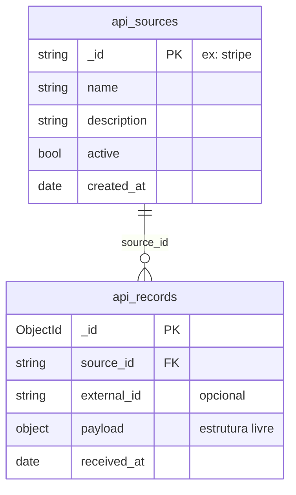

# Arquitetura do Banco de Dados

## Visão geral

```
integration_hub            (banco)
├── api_sources            (catálogo das fontes integradas)
└── api_records            (coleção principal: dados recebidos)
```

**Decisão central:** **não** existe uma coleção por API (`stripe_payments`, `rh_candidates`...).
Todas as fontes gravam na mesma coleção `api_records`. Adicionar uma nova API significa
**cadastrar um documento** em `api_sources`. Nenhuma coleção nova, nenhuma migração.



---

## Coleção `api_sources`

Catálogo das APIs integradas. **Não guarda dados de negócio**: só identifica e descreve cada fonte.

```json
{
  "_id": "stripe",
  "name": "Stripe",
  "description": "API de pagamentos",
  "active": true,
  "created_at": ISODate("2026-11-03T12:00:00Z")
}
```

- `_id` é um identificador legível (`stripe`, `rh_app`), usado como `source_id` nos registros.
- `active` permite desligar uma integração sem apagar os dados históricos. A API recusa
  novos registros de fontes inativas.

## Coleção `api_records`

Guarda os documentos recebidos. **Regra de ouro:**

> Tudo que é **específico de uma API** fica dentro de `payload`.
> Tudo que serve para **identificar, organizar e consultar** fica fora dele.

| Campo         | Tipo     | Responsabilidade                                    |
| ------------- | -------- | --------------------------------------------------- |
| `_id`         | ObjectId | Identificador único do documento                    |
| `source_id`   | string   | Qual API enviou (referência a `api_sources._id`)    |
| `external_id` | string?  | ID original na API de origem, quando existir        |
| `payload`     | object   | Conteúdo original recebido, **sem schema fixo**     |
| `received_at` | Date     | Data e hora do recebimento                          |

### Mesma coleção, formatos diferentes

```json
// Stripe: pagamento (campos simples)
{ "source_id": "stripe", "external_id": "evt_12345",
  "payload": { "customer": "Maria", "amount": 250.0, "currency": "BRL", "status": "paid" } }

// RH: candidato (array de strings + documento aninhado)
{ "source_id": "rh_app", "external_id": "candidate_988",
  "payload": { "candidate": "Juliana", "position": "Engenheira de Dados",
               "skills": ["Python", "MongoDB", "Spark"],
               "contact": { "email": "juliana@example.com", "city": "Uberlândia" } } }

// ERP: pedido (array de objetos)
{ "source_id": "erp", "external_id": "order_1001",
  "payload": { "order_number": 1001, "client": "Supermercado Central",
               "items": [ { "sku": "CAF-500G", "qty": 50, "unit_price": 18.9 } ],
               "total": 1153.0 } }
```

---

## Índices

| Nome                   | Campos                                | Finalidade                                                    |
| ---------------------- | ------------------------------------- | ------------------------------------------------------------- |
| `idx_source`           | `{ source_id: 1 }`                    | Consultas por fonte                                           |
| `idx_source_received`  | `{ source_id: 1, received_at: -1 }`   | Consultas por fonte ordenadas pelos mais recentes             |
| `uniq_source_external` | `{ source_id: 1, external_id: 1 }`    | **Único e parcial**: impede receber o mesmo evento duas vezes |

O índice `uniq_source_external` usa `partialFilterExpression: { external_id: { $type: "string" } }`.
Assim, a unicidade só vale quando o `external_id` existe. Fontes que não mandam ID
continuam podendo gravar vários registros. Isso garante **idempotência**: se a API externa
reenviar o mesmo webhook, o hub recusa a duplicata (HTTP 409).

> O índice `idx_source` é, tecnicamente, coberto pelo prefixo de `idx_source_received`.
> Ele foi mantido por clareza didática. Em produção poderia ser removido.

---

## Comparação com a proposta original (PostgreSQL + JSONB)

| Conceito             | PostgreSQL + JSONB                           | MongoDB                                         |
| -------------------- | -------------------------------------------- | ----------------------------------------------- |
| Estrutura            | Tabela `integracao_api` com coluna `JSONB`   | Coleção `api_records` com campo `payload`       |
| Identificação        | `sistema VARCHAR(100)`                       | `source_id` + catálogo `api_sources`            |
| Inserção             | `INSERT ... VALUES ('Stripe', '{...}')`      | `insertOne({ source_id, payload })`             |
| Acesso a campo       | `dados->>'cliente'`                          | `"$payload.customer"`                           |
| Conversão de tipo    | `(dados->>'valor')::NUMERIC`                 | Desnecessária: BSON preserva tipos (Double, Int, Date) |
| Filtro em campo      | `WHERE dados->>'status' = 'paid'`            | `find({ "payload.status": "paid" })`            |
| Arrays               | `dados->'skills' ? 'Python'`                 | `find({ "payload.skills": "Python" })`          |

No MongoDB a ideia é ainda mais natural: o documento **é** o formato nativo de armazenamento,
e não uma coluna especial dentro de uma tabela relacional.

---

## Consultas de demonstração

Todas estão em [`database/queries.js`](../database/queries.js):

1. Todos os registros de uma fonte (`find`)
2. Filtro em campo interno (`payload.status = "paid"`)
3. **Query Mágica**: `$project` transforma o payload em colunas
4. Comparação numérica (`payload.amount > 200`)
5. Busca em array (`payload.skills = "Python"`)
6. Busca em array de objetos (`payload.items.sku`)
7. Campo opcional (`$exists`): heterogeneidade na prática
8. Agregação: soma por status (`$group`)
9. Registros por fonte e último recebimento
10. **Descoberta de schema** (`$objectToArray`): quais campos cada fonte envia
11. Junção com o catálogo (`$lookup`)
12. Plano de execução (`explain`) comprovando o uso de índice
