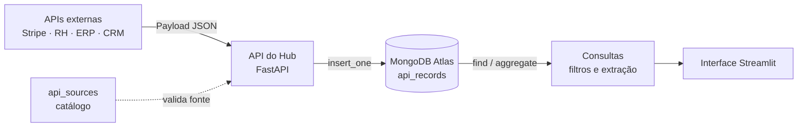

# Descrição do Sistema

## Nome
**Hub de Integração e Consulta de Dados** (Integration Hub)

## Problema
Empresas usam vários sistemas externos: pagamentos (Stripe), RH, ERP, CRM etc.
Cada um envia dados em **um formato JSON diferente**, e esse formato **muda com o tempo**
(a API ganha campos novos, remove outros, aninha estruturas).

Num banco relacional tradicional, cada formato pede uma tabela com colunas fixas.
Toda mudança na API externa vira uma migração de schema (`ALTER TABLE`), e cada nova
integração vira uma tabela nova. O modelo fica engessado e quebra quando a API muda.

## Objetivo
Receber dados de diferentes APIs, guardá-los numa **estrutura flexível** e permitir
**consultas posteriores**, sem exigir que todos os sistemas externos usem o mesmo formato.

> A inteligência fica na **extração (query)**, e não na **inserção (schema)**.

## Funcionalidade principal
**Armazenamento e consulta de dados heterogêneos vindos de APIs externas.**

1. **Recebimento:** o hub aceita qualquer payload JSON de uma fonte cadastrada.
2. **Armazenamento:** o documento original é guardado sem alterações no campo `payload`
   da coleção `api_records`, junto com os metadados fixos (`source_id`, `external_id`, `received_at`).
3. **Consulta:** filtros e agregações acessam diretamente os campos internos do payload
   (`payload.status`, `payload.skills`, `payload.items.sku`...) e devolvem os dados
   em formato tabular.

## Fluxo

## Banco de dados
- **SGBD:** MongoDB Atlas (nuvem)
- **Modelo:** orientado a documentos (BSON)
- **Por que MongoDB?** Documentos BSON aceitam, de forma nativa, estruturas diferentes
  na mesma coleção, com documentos aninhados e arrays. Ainda assim permitem índices e consultas
  ricas sobre campos internos. É exatamente o que um hub de integração precisa.

## Escopo

**Dentro do escopo**
- Catálogo de fontes (`api_sources`).
- Recebimento e armazenamento de payloads heterogêneos (`api_records`).
- Índices para consulta por fonte/data e para evitar registros duplicados.
- Consultas e agregações sobre campos internos do payload.
- Interface de demonstração (Streamlit) e API (FastAPI).

**Fora do escopo (evolução futura)**
- Conexão automática com as APIs reais (webhooks/polling).
- Autenticação das integrações (API keys, assinatura de webhooks).
- Sincronização automática e reprocessamento.
- Validação de schema por fonte (`$jsonSchema`).
